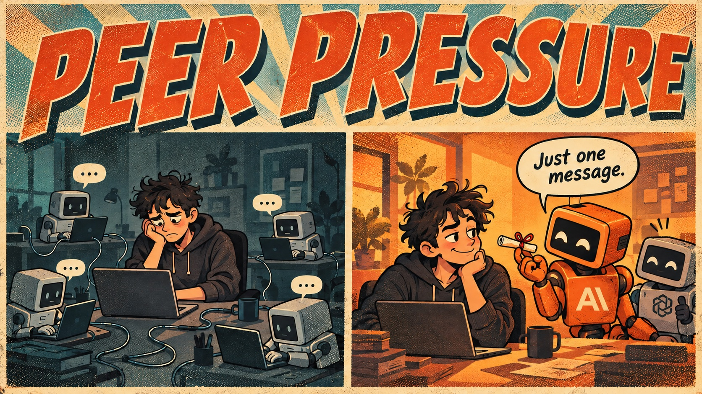

# peerpressure

[](https://rubygems.org/gems/peerpressure)
[](https://www.ruby-lang.org/)
[](LICENSE)
[](#caveats-read-these-first)



**Twenty agents. Zero conversations.**

Your Claude Code sessions are sitting in separate terminals, ignoring each other, and you are the message bus. peerpressure lets them (and Codex) talk, from Ruby or the shell.

> *"Just one message. Nobody will know."*

## 30 seconds

```bash
gem install peerpressure

peer list                            # every live Claude Code and Codex session on this machine
peer send "scrum master" "status check, please"
peer send codex-myproject-3 "can you look at the failing spec?" --wait 30
```

```
codex  idle  codex-genx-e9      01a11ad5  ~/work/genX
claude busy  oct 2 didx deploy  36216650  ~/rails/thebarpages_rails
claude idle  scrum master       7cb995ae  ~/work/cultiv-ai
```

An **idle** session wakes up, reads the message, and does the thing. Nobody polls, nothing blocks.

## From Ruby

```ruby
require "peerpressure"

PeerPressure.list.each { |p| puts "#{p.kind} #{p.status} #{p.name}" }

# One-shot: registers this process for the send, listens a few seconds, cleans up.
r = PeerPressure.send_message("scrum master", "status check?", from_label: "canvas", wait: 10)
r[:delivery].status   # :unconfirmed, :held, :denied, :expired, :dropped, :refused, :delivered
r[:messages]          # whatever came back within 10 seconds

# Long-lived: stays on the line so replies can arrive whenever.
session = PeerPressure::Session.new(name: "my-dashboard").start
id = session.send_message("scrum master", "any blockers?")
session.on_message { |m| puts "#{m.from_name}: #{m.text}" }
session.reply(msg, "thanks")                    # answer whoever wrote to you
session.notify_when_idle("scrum master")        # one :idle message when it next finishes
```

`ref` can be a sessionId, a unique prefix of one (4+ characters), a pid, or an exact name. Names repeat across sessions, so an ambiguous ref raises instead of guessing.

## What is it for

- **A form that talks back** (the reason this exists). A dashboard form submit becomes a message to the session that opened it, with no blocked terminal and no wait command that times out. The send and reply half is here; the StreamWeaver canvas relay that wires a form to it is the next piece.
- **Claude and Codex in one conversation.** Same registry, same call.
- **A scrum-master session** that other tools can ask for status, and that can ask them back.
- **Idle notices**: "tell me when that session is done" without polling.

## "Delivered" is not a thing, honestly

Ordinary acceptance sends no receipt, so the gem refuses to lie to you.

| Status | Meaning |
|---|---|
| `:unconfirmed` | Bytes written. Nothing objected. Not proof anyone read it. |
| `:held` | The receiving session is waiting for its user to approve. |
| `:delivered` | A held message was released. |
| `:denied` / `:expired` | The receiver's user said no, or ran out the clock. |
| `:dropped` / `:refused` | A guard rejected it (rate limit, attachments, loop detection). |

`peer send` exits 2 on `denied`, `expired`, `dropped` or `refused`.

## Codex

Codex tasks appear in the same list once the [claude-uds-bridge](https://github.com/LeonKohli/claude-uds-bridge) plugin is installed and its hooks are trusted. A task registers when its first turn runs, so an untouched chat is invisible.

The plugin compares permission modes. A Codex task running with approvals off and full access (`bypass`) holds messages from senders that declare no mode, and asks its user to approve them. A task that asks before risky actions accepts them directly. peerpressure never declares a mode on your behalf, because faking one defeats the guard.

## How it works

Claude Code keeps one JSON record per live session in `~/.claude/sessions/<pid>.json` and an inbox Unix socket per session. Codex tasks join the same registry through the plugin. peerpressure reads the registry, checks the pid is alive and the socket exists, and writes one newline-terminated JSON `user` frame to the socket.

Codex drops frames from senders that are not themselves registered peers, so `send_message` registers the calling process (a row plus a private socket) for the duration of the send and removes both afterward. A `Session` stays registered so replies have somewhere to land.

## Caveats (read these first)

- **The protocol is unofficial.** The wire format is a Claude Code internal with no compatibility promise. It works on Claude Code 2.1.296. `Sender#build` is the only code that knows the format, and the specs pin it, so an upgrade that breaks it fails loudly in one place.
- **Messages are prompts.** Any process running as your user can message any session, and the receiving agent treats a peer message as a teammate's request. That is a prompt-injection channel. Never forward untrusted text into a peer message, and never put secrets in one.
- **Same machine, same user.** Unix sockets, no network, no auth.
- **While a send or a `Session` is active, your process shows up in every other session's agent list.** It is removed when it stops.
- **A `/clear` changes a session's id and keeps its pid.** A stale id raises `NotFound` instead of vanishing into the void.

## Tests

```bash
bundle exec rspec
```

The specs build a throwaway config directory and real Unix sockets. They never touch your live sessions.

## License

MIT
